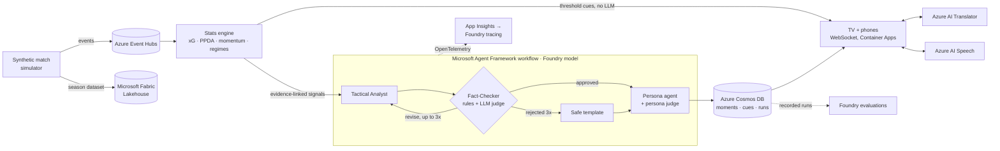

# Second Screen: Explainable Live Match Intelligence

A multi-agent system that turns a live synthetic football match into fact-checked moments,
broadcast-ready overlays, and personalized experiences for analysts and casual fans.

Built for the Microsoft + Premier League *Inside the Game* Developer Hackathon.
All clubs, players, and match data are fictional and synthetically generated.

## Pipeline

| Stage | Component | Status |
|---|---|---|
| Ingest | `secondscreen.simulator`: synthetic match engine → event stream | ✅ |
| Interpret | `secondscreen.stats`: possession, PPDA, pressing intensity, xG, pass difficulty, momentum, control/chaos, evidence-linked signals | ✅ |
| Explain | `secondscreen.agents`: Tactical Analyst → Fact-Checker (revise loop) → Recap, on Microsoft Agent Framework + Foundry | ✅ |
| Render | Timed, machine-readable overlay cues (lower thirds, player tags, stat pops) | ✅ |
| Personalize | Persona agent: analyst / casual, favourite club, player cam, EN / ES / FR | ✅ |
| Any language | Azure AI Translator on every phone (18 languages), numbers checked against the original | ✅ |
| Commentary | Commentator agent writes play-by-play + co-commentator lines (EN / ES / FR), fact-checked; two-voice Azure AI Speech booth with a generated crowd | ✅ |
| Highlights | Auto-played reel of every goal, red card and story moment | ✅ |
| Dataset | 56-match synthetic season with ground-truth labels, Parquet → Microsoft Fabric | ✅ |
| Operate | Container Apps + Event Hubs + Cosmos DB, managed identity, OpenTelemetry → Foundry tracing, Foundry evaluations | ✅ |

## The simulator

A possession-by-possession model of a 90-minute match between two fictional clubs:
**Halcyon City** (patient possession, mid-block) and **Redmarsh Rovers** (direct, high press).

- Every pass, carry, pressure, tackle, interception, shot, save, foul, card, corner and substitution
  is emitted with an event ID, match clock, x/y coordinates (105×68 m) and player references.
- Raw measurements: pass distance, ball speed, shot speed, sprint speed, and distance covered
  (in physical snapshots every 5 minutes).
- Player fatigue, tactical blocks (high press / mid block / low block) and game-state reactions
  (chasing teams press, leading teams sit deep) drive the probabilities.
- **Hidden story arcs** bend each match: a pressing spell, a star takeover, a late fatigue fade,
  a late surge from the trailing side. Arcs are **never in the event feed**; they go into a separate
  `*.truth.json` so we can measure whether the stats engine and agents rediscover them from raw events.

Calibrated across 150 simulated matches: ~2.9 goals, ~27 shots, ~81% pass completion,
~9.6 km per player, top sprint speeds of 32–36 km/h.

### Usage

```bash
pip install -e ".[agents,dev]"

# Simulate one match → data/match_SS00076.jsonl + data/match_SS00076.truth.json
python -m secondscreen.simulator generate --seed 76

# Find dramatic seeds (lead changes, comebacks, late goals)
python -m secondscreen.simulator scan --seeds 400 --top 10

# Replay as a live stream at 20× speed (a 90-minute match in ~5 minutes)
python -m secondscreen.simulator replay data/match_SS00076.jsonl --speed 20 --compact

pytest
```

### Demo match: seed 76

Halcyon City 4–2 Redmarsh Rovers. Redmarsh press high early and lead 2–1, then go down to ten men
at 54', fade physically, and get overrun as Halcyon throw everything forward in the last 20 minutes.

### Event schema (example)

```json
{
  "event_id": "SS00076-00301", "match_id": "SS00076", "seq": 301,
  "period": 1, "clock": "09:04", "clock_seconds": 544.9, "elapsed_seconds": 544.9,
  "type": "pass", "team_id": "RED", "player_id": "RED-07", "player_name": "…",
  "x": 10.4, "y": 46.1, "end_x": 17.8, "end_y": 52.3,
  "outcome": "complete", "recipient_id": "RED-11",
  "distance_m": 9.7, "ball_speed_kmh": 38.6, "under_pressure": false,
  "height": "ground", "progressive_m": -7.5,
  "score": {"HAL": 0, "RED": 0}, "possession_id": 31
}
```

Coordinates are normalised so the home team always attacks toward x = 105.

## The stats engine

`secondscreen.stats.StatsEngine` ingests events one at a time (the same code path for live
streams and batch replays) and emits **signals**: goals with game state, big chances, red cards,
speed alerts, elite passes, momentum swings, control/chaos regime changes, pressing spells,
hot streaks, fatigue fades, and late surges.

Every signal carries the stat values (`facts`) and the event IDs (`evidence`) behind it.
That contract is what lets the Fact-Checker agent reject any sentence it can't trace to data.

Key definitions:
- **xG**: location model (distance + goal-mouth angle), discounted for headers and free kicks
- **Pass difficulty (0–10)**: how often an average passer fails that pass, from distance,
  progression, pressure and whether it ends in the box
- **PPDA**: opponent passes in their own 60% per defensive action there
- **Pressing intensity**: high defensive actions per minute of opponent possession versus the
  team's own baseline, shrunk with a pseudo-count so low-pressing sides don't trigger on noise
- **Momentum (−100…100)**: exponentially decayed threat (box entries, shots weighted by xG,
  high turnovers, corners)
- **Regime**: control (one side ≥66% of the ball over 5 minutes), chaos (≥3.4 possession
  changes a minute), or balanced, with confirmation and dwell time to avoid flicker

### Does it find the hidden stories?

Detectors were tuned on seeds 0–39 and scored on 60 **held-out** matches (`seeds 1000–1059`):

| Hidden arc | Recall | Precision | Detections per match |
|---|---|---|---|
| Late surge | 0.87 | 0.65 | 1.2 |
| Fatigue fade | 0.78 | 0.57 | 1.4 |
| Pressing spell | 0.68 | 0.36 | 2.7 |
| Star takeover (hot streak) | 0.35 | 0.48 | 0.7 |

Pressing precision counts detections that line up with a real tactical switch (e.g. a side
chasing the game) as correct. Hot streaks deliberately favour precision: a false
"he's taking over" on air is worse than a missed one.

```bash
python -m secondscreen.stats data/match_SS00076.jsonl --out data   # signals + snapshot
python -m secondscreen.stats.evaluate --seeds 60 --start 1000       # detector scorecard
```

## The agents

Built on **Microsoft Agent Framework** (`Agent`, `WorkflowBuilder`) with models served from
**Microsoft Foundry**.

```
signal ──► Tactical Analyst ──draft──► Fact-Checker ──approved──► Persona ──► moment + overlay cues
               ▲                          │    │
               └──── revise (feedback) ───┘    └── rejected 3× / model outage ──► Fallback template
```

| Agent | Job | Output |
|---|---|---|
| Tactical Analyst | Explains *why* a flagged moment matters (game state, pressing, momentum, control vs chaos) | `MomentDraft`: headline, summary, why it matters, claims citing fact keys |
| Fact-Checker | Deterministic grounding rules (every number, name and fact key must trace to the stats engine), then an LLM judge for causal and semantic support | approve, or send back specific feedback |
| Persona | Renders the approved moment for each viewer: analyst or casual, favourite club, player cam, language | one rendering per persona, re-checked; any that adds a number or person is replaced |
| Recap | Full-time report from approved moments and final stats only | `Recap`, checked with the same rules |

Design choices:
- **Numbers come from code, words come from models.** Agents only ever see a flat table of
  `key = value` facts and must cite keys for every claim, which makes fact-checking mechanical.
- **Models only where language adds value.** Speed tags, cards, substitutions and pass-difficulty
  pops are deterministic overlay cues and render instantly.
- **Failure is a path, not a crash.** A rejected draft gets specific feedback; after two revisions,
  or if the model times out or returns bad JSON, a fact-safe template goes to air instead.
- **Record / replay.** Live runs cache every model response, so the demo replays exactly with no
  network and no cost.

Overlay cue (what a rendering partner consumes):

```json
{"cue_id": "SS00076-M028-halcyon_fan", "persona_id": "halcyon_fan", "lang": "en",
 "type": "lower_third", "clock": "79:46", "elapsed": 4910.2, "duration_s": 10, "priority": 1.0,
 "team_id": "HAL", "player_id": "HAL-08",
 "text": {"strap": "…", "card": "…"}, "stats": [{"label": "xG", "value": "0.31"}],
 "evidence": ["SS00076-02281", "…"]}
```

### Running the agents

```bash
pip install -e ".[agents,dev]"

# Offline: deterministic mock model (CI uses this)
python -m secondscreen.agents data/match_SS00076.jsonl --mode mock --inject-errors 4

# Live against Foundry, recording every response to data/llm_cache.jsonl
cp .env.example .env    # fill in your endpoint; key or `az login`
python -m secondscreen.agents data/match_SS00076.jsonl --mode record

# Replay the recorded run: no network, identical output
python -m secondscreen.agents data/match_SS00076.jsonl --mode replay
```

Auth: set `AZURE_OPENAI_ENDPOINT` + `AZURE_OPENAI_API_KEY`, or set `AZURE_AI_PROJECT_ENDPOINT`
and run `az login` (grant yourself access once with `infra/grant-access.sh`).

## One command: any match, ready to watch

```bash
python -m secondscreen.produce --seed 123 --serve      # or --best-of 200, or --match data/match_X.jsonl
```

Simulates the match, runs the agents (analyst, fact-checker, personas, commentator) on Foundry if
`.env` has credentials or on the offline mock if not, pre-translates the phones, voices the
commentary with Azure AI Speech, and opens the highlights reel for it. Each step that can't run
(no credentials, say) is skipped with the reason. Pick any produced match from the header.

## Watch it: the broadcast + second screen UI

```bash
pip install -e ".[agents,server,dev]"
python -m secondscreen.server          # open http://localhost:8000
```

- **The TV** plays the synthetic match as a broadcast: ball and 22 players animated from the
  event feed, scorebug, game-state chip, player tags (speed, shot speed, cards) and on-air
  lower thirds that wipe in as the agents publish.
- **Two phones** show the second-screen app for two viewer profiles side by side (analyst,
  Halcyon fan, Redmarsh fan in Spanish, Lazaro player cam in French). Same moment, different story.
- **Tap any card** to see why it's on screen: each claim, the exact facts it cites, the
  fact-check trail (rejections, revisions, judge verdicts) and the source event IDs.
- Below the TV: a momentum river for the whole match and a live stat duel.

Controls: agent source (recorded live run, offline mock, or live Foundry), start point, speed,
and, for recorded runs, a timeline scrubber: drag to any minute (back or forward), or click a goal /
red-card marker to jump to just before it. Seeking rebuilds the stats engine's state up to that
point instantly. Live and offline-model modes have no scrubber, since agent moments are written as
the match plays.
The server replays the event file on its real timestamps; the stats engine runs on every event
and agent moments run in a background queue, so the stream never waits on a model.

The UI is React + TypeScript (`web/`); `npm run build` writes into the Python package so the
server ships it.

More on the phones and TV:

- **Translate any phone** with the language picker (Azure AI Translator). A translation is only shown
  if every number in it matches the fact-checked original; otherwise the card stays in its original
  language and says so. Arabic and other right-to-left languages lay out right-to-left.
- **Commentary on** reads the TV's strap for each new big moment aloud (Azure AI Speech, one neural
  voice per language). Goals and red cards cut in; smaller moments wait their turn.
- **Highlights** (recorded runs) plays every goal and red card plus the best story moments, each from
  just before it happens. `?reel=1` starts it on load.

## Architecture



## Deploy to Azure

GitHub Actions tests every push, builds the image and pushes it to GitHub Container Registry.
`infra/main.bicep` creates Container Apps, Event Hubs, Cosmos DB (serverless), Log Analytics and
App Insights, and gives the app a managed identity with roles on each service: no keys anywhere.

```bash
# Azure Cloud Shell, from the repo root
FOUNDRY=<your Foundry resource> bash infra/deploy.sh   # prints the URL and a start token
```

Open the URL and pick **On air**: everyone watching sees the same match, fed through Event Hubs,
with moments stored in Cosmos DB so late joiners catch up.

## Measure it

```bash
# Detector recall against the simulator's hidden truth, on held-out matches (runs in CI)
python -m secondscreen.stats.evaluate --seeds 20 --start 1000

# Foundry evaluations of every published moment: groundedness, relevance, coherence and our
# deterministic grounding rules; --upload logs the run to the Foundry project
pip install -e ".[agents,eval]"
python -m secondscreen.agents.foundry_eval data/match_SS00076.jsonl --upload
```

Set `APPLICATIONINSIGHTS_CONNECTION_STRING` (the deployed app has it) and every agent run, model
call and workflow step is traced with OpenTelemetry. Connect the App Insights resource to the
Foundry project (**Tracing**) to inspect them there.

## A season of data for Microsoft Fabric

```bash
pip install -e ".[data]"
python -m secondscreen.dataset                                   # data/season/*.parquet
python -m secondscreen.dataset --onelake "<workspace>/<lakehouse>"  # + upload to Fabric
```

Eight invented clubs, a 56-match double round-robin, about 150,000 events. Every match runs through
the same simulator and stats engine as the demo, and the hidden story arcs come along as labels:
`clubs`, `players`, `matches`, `standings`, `events`, `signals` (with evidence event ids), `arcs`
(ground truth, detected or not, and how late) and `player_match`. `fabric/load_season.py` loads them
into Delta tables in a Fabric notebook and asks the data questions: detector recall by arc type,
the xG league table, season leaders.

## Make the demo work offline

Translations and voice clips are cached in `data/`, so a recorded demo needs no Azure at view time.
Fill the caches once from a machine with the Foundry key in `.env`:

```bash
python -m secondscreen.cloud.translate data/match_SS00076 --to de,pt,hi,ja,ar,sw
python -m secondscreen.agents.commentary data/match_SS00076 --mode record   # commentary script (Foundry)
python -m secondscreen.cloud.speech --voices                                 # pick voices for your region
python -m secondscreen.cloud.speech data/match_SS00076                       # voice it
```

## Tech stack

| | |
|---|---|
| Microsoft Foundry | gpt-4.1-mini deployment, tracing, evaluations |
| Microsoft Agent Framework | analyst → fact-checker → persona workflow, recap agent |
| Azure AI services | Translator (any-language phones), Speech (spoken commentary) |
| Azure cloud-native | Container Apps, Event Hubs, Cosmos DB, Managed Identity, App Insights, Bicep |
| Microsoft Fabric | Lakehouse season dataset (OneLake), Delta tables |
| GitHub | public repo, Actions CI/CD, Container Registry |
| App | Python 3.12, FastAPI, React 18 + TypeScript, Canvas |
